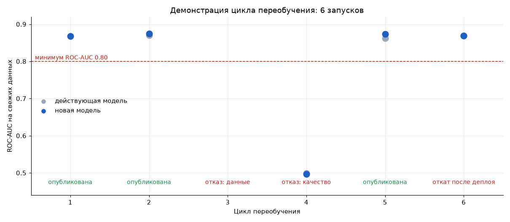

# Демонстрация цикла переобучения

Документ показывает, что процесс из [Model_retrain_BPMN.md](../Model_retrain_BPMN.md) работает в коде: цикл
переобучения запущен 6 раз подряд на реальных данных, и в каждом запуске пройдены настоящие проверки. Отчёт
сгенерирован автоматически скриптом:

```bash
poetry run python scripts/retrain_demo.py
```

Отдельный цикл запускается командой (последний файл это новая партия данных, остальные это окно обучения):

```bash
poetry run insurance retrain --data data/batches/batch_01.csv data/batches/batch_02.csv --trigger new_data
poetry run insurance monitor --data data/batches/batch_05.csv
```

Без флага `--auto-approve` команда `retrain` перед публикацией спрашивает одобрение у человека (ручная задача
в BPMN). В демонстрации одобрение автоматическое, это записано в реестре как `auto (демо)`.

## 1. Данные

Источник: Kaggle Playground Series S4E7, 11 504 798 клиентов, у 12.3% ответ «интересно» (`Response` = 1).
Дат в данных нет, поэтому поступление новых данных имитируется: стратифицированная выборка нарезана на 6
партий по 200000 клиентов, как будто это данные за 6 периодов. Партии 3, 4 и 5 испорчены специально, чтобы
проверить ветки неуспеха и реакцию на дрейф.

### Как выглядят данные (первые строки партии 1)

| id | Gender | Age | Driving_License | Region_Code | Previously_Insured | Vehicle_Age | Vehicle_Damage | Annual_Premium | Policy_Sales_Channel | Vintage | Response |
|---|---|---|---|---|---|---|---|---|---|---|---|
| 6583921 | Female | 39 | 1 | 28.0 | 0 | 1-2 Year | Yes | 39558.0 | 124.0 | 283 | 0 |
| 10128318 | Male | 21 | 1 | 8.0 | 1 | < 1 Year | No | 33273.0 | 160.0 | 31 | 0 |
| 4244836 | Male | 45 | 1 | 28.0 | 1 | 1-2 Year | No | 42298.0 | 124.0 | 120 | 0 |
| 4092588 | Male | 40 | 1 | 28.0 | 0 | 1-2 Year | Yes | 33171.0 | 124.0 | 148 | 0 |
| 6682238 | Female | 23 | 1 | 41.0 | 1 | < 1 Year | No | 29091.0 | 152.0 | 123 | 0 |

### Партии

| batch | rows | positive_rate | max_psi | note |
|---|---|---|---|---|
| batch_01 | 200000 | 0.1233 | 0.000 (Age) | обычные данные |
| batch_02 | 200000 | 0.1235 | 0.000 (Age) | обычные данные |
| batch_03 | 200000 | 0.1224 | 0.000 (Age) | испорчена схема: неизвестный пол и пропуски премии |
| batch_04 | 200000 | 0.1229 | 0.000 (Annual_Premium) | ошибка разметки: ответы клиентов перемешаны |
| batch_05 | 200000 | 0.1226 | 3.130 (Age) | дрейф: клиенты старше на 10 лет |
| batch_06 | 200000 | 0.1231 | 0.000 (Age) | обычные данные |

PSI (индекс стабильности распределения) считается относительно партии 1: меньше 0.1 означает, что
распределение не изменилось, больше 0.2 означает существенный сдвиг.

## 2. Сценарий

| Цикл | Триггер | Окно обучения | Что проверяем |
|---|---|---|---|
| 1 | ручной запуск | партия 1 | первая версия модели, сравнивать не с чем |
| 2 | новые данные | партии 1-2 | новая модель против действующей на свежих данных |
| 3 | расписание | партии 2-3 | испорченная схема данных должна остановить цикл до обучения |
| 4 | новые данные | партии 2 и 4 | ошибка разметки должна провалить проверки качества |
| 5 | дрейф | партии 2 и 5 | команда `monitor` находит дрейф и запускает переобучение |
| 6 | расписание | партии 5-6 | имитация сбоя после деплоя: должен сработать откат |

В каждом цикле 25% новой партии откладываются и не участвуют в обучении: на них сравниваются новая модель и
действующая. Модель: LightGBM в быстрой конфигурации (параметры из `config.BEST_PARAMS`).

## 3. Результаты циклов



| Цикл | Триггер | Данные | Действующая | ROC-AUC действующей | ROC-AUC новой | F1 новой | Решение | Версия | В работе после | Время, с |
|---|---|---|---|---|---|---|---|---|---|---|
| 1 | ручной | batch_01 | нет | - | 0.8681 | 0.4742 | опубликована | v1 | v1 | 12 |
| 2 | новые данные | batch_01 + batch_02 | v1 | 0.8697 | 0.8751 | 0.4780 | опубликована | v2 | v2 | 25 |
| 3 | расписание | batch_02 + batch_03 | v2 | - | - | - | отказ: данные | - | v2 | 0 |
| 4 | новые данные | batch_02 + batch_04 | v2 | 0.4990 | 0.4962 | 0.1438 | отказ: качество | v3 | v2 | 23 |
| 5 | дрейф | batch_02 + batch_05 | v2 | 0.8625 | 0.8736 | 0.4805 | опубликована | v4 | v4 | 24 |
| 6 | расписание | batch_05 + batch_06 | v4 | 0.8687 | 0.8686 | 0.4694 | откат после деплоя | v5 | v4 | 25 |

## 4. Проверки в каждом цикле

**Цикл 1** (ручной, опубликована)

- ✓ схема и значения данных: columns and values ok
- ✓ объём партии: 200000 rows (minimum 1000)
- ✓ доля положительного класса: 0.123 (expected 0.123 +/- 0.030)
- ✓ минимальный ROC-AUC: ROC-AUC 0.8681 (minimum 0.80)
- ✓ главные признаки: top features: ['Vehicle_Damage', 'Previously_Insured']
- ✓ тест загрузки модели: saved model reloads and predicts

**Цикл 2** (новые данные, опубликована)

- ✓ схема и значения данных: columns and values ok
- ✓ объём партии: 200000 rows (minimum 1000)
- ✓ доля положительного класса: 0.124 (expected 0.123 +/- 0.030)
- ✓ минимальный ROC-AUC: ROC-AUC 0.8751 (minimum 0.80)
- ✓ ROC-AUC не хуже действующей: 0.8751 vs champion 0.8697 (allowed drop 0.002)
- ✓ F1 не хуже действующей: 0.4780 vs champion 0.4697 (allowed drop 0.005)
- ✓ качество по группам клиентов: largest drop -0.0031 in Vehicle_Age=< 1 Year (allowed 0.02)
- ✓ главные признаки: top features: ['Vehicle_Damage', 'Previously_Insured']
- ✓ тест загрузки модели: saved model reloads and predicts
- дрейф к обучающим данным действующей модели: максимум PSI 0.000 (Age)

**Цикл 3** (расписание, отказ: данные)

- ✗ схема и значения данных: Missing values in columns: ['Annual_Premium']

**Цикл 4** (новые данные, отказ: качество)

- ✓ схема и значения данных: columns and values ok
- ✓ объём партии: 200000 rows (minimum 1000)
- ✓ доля положительного класса: 0.123 (expected 0.123 +/- 0.030)
- ✗ минимальный ROC-AUC: ROC-AUC 0.4962 (minimum 0.80)
- ✗ ROC-AUC не хуже действующей: 0.4962 vs champion 0.4990 (allowed drop 0.002)
- ✗ F1 не хуже действующей: 0.1438 vs champion 0.1685 (allowed drop 0.005)
- ✓ качество по группам клиентов: largest drop +0.0076 in Vehicle_Age=< 1 Year (allowed 0.02)
- ✓ главные признаки: top features: ['Vehicle_Damage', 'Previously_Insured']
- ✓ тест загрузки модели: saved model reloads and predicts
- дрейф к обучающим данным действующей модели: максимум PSI 0.000 (Age)

**Цикл 5** (дрейф, опубликована)

- ✓ схема и значения данных: columns and values ok
- ✓ объём партии: 200000 rows (minimum 1000)
- ✓ доля положительного класса: 0.123 (expected 0.123 +/- 0.030)
- ✓ минимальный ROC-AUC: ROC-AUC 0.8736 (minimum 0.80)
- ✓ ROC-AUC не хуже действующей: 0.8736 vs champion 0.8625 (allowed drop 0.002)
- ✓ F1 не хуже действующей: 0.4805 vs champion 0.4613 (allowed drop 0.005)
- ✓ качество по группам клиентов: largest drop -0.0020 in Age=30-39 (allowed 0.02)
- ✓ главные признаки: top features: ['Vehicle_Damage', 'Previously_Insured']
- ✓ тест загрузки модели: saved model reloads and predicts
- дрейф к обучающим данным действующей модели: максимум PSI 3.135 (Age)

**Цикл 6** (расписание, откат после деплоя)

- ✓ схема и значения данных: columns and values ok
- ✓ объём партии: 200000 rows (minimum 1000)
- ✓ доля положительного класса: 0.123 (expected 0.123 +/- 0.030)
- ✓ минимальный ROC-AUC: ROC-AUC 0.8686 (minimum 0.80)
- ✓ ROC-AUC не хуже действующей: 0.8686 vs champion 0.8687 (allowed drop 0.002)
- ✓ F1 не хуже действующей: 0.4694 vs champion 0.4705 (allowed drop 0.005)
- ✓ качество по группам клиентов: largest drop +0.0028 in Age=30-39 (allowed 0.02)
- ✓ главные признаки: top features: ['Vehicle_Damage', 'Previously_Insured']
- ✓ тест загрузки модели: saved model reloads and predicts
- дрейф к обучающим данным действующей модели: максимум PSI 0.199 (Age)


## 5. Обнаружение дрейфа перед циклом 5

Команда `insurance monitor` сравнила партию 5 с данными, на которых обучена действующая модель:

| Признак | PSI |
|---|---|
| Age | 3.135 |
| Annual_Premium | 0.000 |
| Vintage | 0.000 |
| Gender | 0.000 |
| Vehicle_Age | 0.000 |
| Vehicle_Damage | 0.000 |
| Previously_Insured | 0.000 |

Дрейф обнаружен: **да** (порог PSI 0.2), поэтому цикл 5 запущен с триггером `drift`.

## 6. Реестр моделей после демонстрации

| Версия | Статус | Цикл | Триггер | ROC-AUC | F1 | Строк обучения |
|---|---|---|---|---|---|---|
| v1 | archived | 1 | ручной | 0.8681 | 0.4742 | 150000 |
| v2 | archived | 2 | новые данные | 0.8751 | 0.478 | 350000 |
| v3 | rejected | 4 | новые данные | 0.4962 | 0.1438 | 350000 |
| v4 | production | 5 | дрейф | 0.8736 | 0.4805 | 350000 |
| v5 | rolled_back | 6 | расписание | 0.8686 | 0.4694 | 350000 |

В эксплуатации после всех циклов: **v4**. Модели отклонённых циклов не удалены: они сохранены со
статусом `rejected` или `rolled_back` для разбора причин.

## 7. Уведомления

```text
2026-10-12T15:02:22+00:00 [INFO] cycle 1: v1 deployed (was None), ROC-AUC 0.8681
2026-10-12T15:02:47+00:00 [INFO] cycle 2: v2 deployed (was v1), ROC-AUC 0.8751
2026-10-12T15:02:47+00:00 [ERROR] cycle 3: data check failed (Missing values in columns: ['Annual_Premium']); production stays v2
2026-10-12T15:03:10+00:00 [WARNING] cycle 4: v3 rejected by quality gates (min_auc, vs_champion_auc, vs_champion_f1); production stays v2
2026-10-12T15:03:34+00:00 [INFO] cycle 5: v4 deployed (was v2), ROC-AUC 0.8736
2026-10-12T15:03:59+00:00 [ERROR] cycle 6: deploy of v5 failed (simulated failure of the post-deploy check); rolled back to v4
```

Файлы реестра и отчёты каждого цикла в формате JSON лежат в [`retrain_demo/`](retrain_demo/).

## 8. Выводы

Проверка сценария: все 6 циклов завершились так, как задумано в сценарии.

| Ветка процесса из BPMN | Где сработала | Что произошло |
|---|---|---|
| Первая версия без сравнения | цикл 1 | модель прошла абсолютные проверки, одобрена и опубликована как v1 |
| Обновление: новая модель лучше действующей | цикл 2 | на одних и тех же свежих данных новая модель обошла действующую по ROC-AUC и F1, v1 ушла в архив |
| A: данные не прошли проверку | цикл 3 | цикл остановлен до обучения (проверка схемы сообщает о первом найденном нарушении), модель в работе не изменилась |
| B: качество не подошло | цикл 4 | при перемешанных ответах обе модели на свежих данных дают ROC-AUC около 0.5: это признак ошибки в разметке, а не в модели. Новая версия сохранена как `rejected` |
| Триггер по дрейфу | цикл 5 | `monitor` нашёл сдвиг возраста (PSI выше 3), новая модель на сдвинутых данных лучше действующей (ROC-AUC 0.874 против 0.863) и опубликована |
| C: сбой после деплоя | цикл 6 | модель прошла проверки и была опубликована, но проверка после выкладки не прошла: автоматический откат на предыдущую версию |

Во всех неуспешных ветках в эксплуатации остаётся последняя рабочая версия, а причина записана в отчёт цикла
и в журнал уведомлений.
